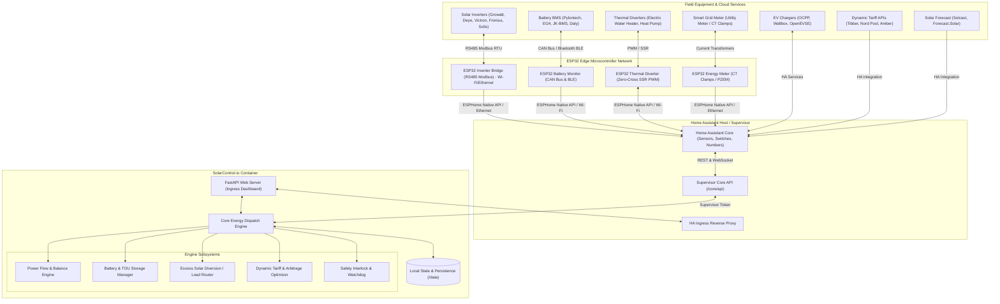

# SolarControl-io: System Design & Architecture Specification

## 1. Executive Summary & Vision

**SolarControl-io** is an edge-native, intelligent Home Assistant Add-on and energy orchestration engine. It coordinates solar photovoltaic (PV) generation, battery energy storage systems (BESS), hybrid inverters, smart electric vehicle (EV) charging, dynamic electric tariffs, deferrable home loads, and distributed **ESP32 microcontrollers**.

Rather than relying on closed cloud-vendor platforms with laggy cloud APIs, SolarControl-io runs locally on the Home Assistant host and distributed ESP32 edge nodes. It computes second-by-second energy balance decisions, maximizes self-consumption, performs automated Time-of-Use (TOU) battery arbitrage, diverts excess solar to thermal or mechanical storage, and prevents costly grid imports during peak tariff periods.

---

## 2. High-Level Architecture

---

## 3. Core Engine Subsystems

### 3.1 Power Flow & Energy Balance Engine (`power_flow.py`)
Maintains a real-time, closed-loop telemetry state of all energy flows:
- **Solar PV Production ($P_{pv}$)**: Aggregated instantaneous generation across all strings/inverters.
- **Grid Exchange ($P_{grid}$)**: Net import ($> 0$) or export ($< 0$) from grid utility meter.
- **Battery Storage ($P_{batt}$)**: Net charging ($> 0$) or discharging ($< 0$), State of Charge ($\% SoC$), and DC voltage/amperage.
- **Home Base Load ($P_{home}$)**: Real-time domestic consumption ($P_{home} = P_{pv} + P_{grid} + P_{batt} - P_{ev} - P_{diverted}$).
- **EV Charging Load ($P_{ev}$)**: Active power consumed by electric vehicles.
- **Diverted Load ($P_{diverted}$)**: Power directed to water heaters, heat pump pre-heating, or dump loads.

### 3.2 Battery Energy Storage System (BESS) Optimizer (`battery_manager.py`)
1. **Self-Consumption Maximization (Default)**: Charges battery whenever $P_{pv} > P_{home}$; discharges when $P_{home} > P_{pv}$ to maintain zero grid import.
2. **Time-of-Use (TOU) & Peak Shaving Arbitrage**: Configurable tariff schedule windows (Off-Peak, Mid-Peak, On-Peak).
3. **Storm & Outage Emergency Reserve**: Raises battery reserve floor (e.g. from 20% to 100%) prior to impending grid loss.
4. **Battery Health & Cell Protection**: Enforces min/max SoC buffers, monitors BMS cell delta voltages and temperatures.

### 3.3 Excess Solar Diversion Engine (`load_diverter.py`)
- **Tier 1: Proportional Thermal Diverter** — Adjusts water heater elements via ESP32 zero-cross SSR or Modbus variable power.
- **Tier 2: EV Solar Smart-Charging** — Modulates EVSE charge current ($6\text{A} - 32\text{A}$) to absorb exact surplus.
- **Tier 3: Heat Pump Pre-conditioning** — Adjusts climate setpoint down in summer or up in winter.
- **Anti-Hunting Hysteresis**: Minimum cycle time watchdog prevents equipment wear.

### 3.4 Dynamic Tariff & Grid Interactivity (`tariff_optimizer.py`)
- Real-time electricity pricing integration (Nord Pool, Tibber, Amber Electric).
- **Negative Pricing Protection**: Immediately curtails inverter generation or ramps up diversion loads when export rates are negative.
- **Grid Export Throttling**: Enforces zero-export or fixed-kW limits at the inverter.

---

## 4. ESP32 Distributed Edge Node Architecture

To interface with heterogeneous equipment in physical environments, SolarControl-io provides turnkey firmware packages for **ESP32** microcontrollers:

### 4.1 Networking Modes: Wi-Fi, Ethernet, and Bluetooth
1. **Wired Ethernet (LAN8720 / W5500 / WT32-ETH01 / Olimex ESP32-POE)**:
   - Primary recommendation for electrical utility closets and noisy inverter enclosures.
   - Immune to 2.4 GHz RF interference from high-frequency inverter switching.
   - Low latency ($< 2\text{ms}$) deterministic communication.
2. **Wi-Fi (802.11 b/g/n)**:
   - Ideal for sub-panels, outdoor solar arrays, and domestic water heaters where running Ethernet is impractical.
3. **Bluetooth LE (BLE)**:
   - Direct wireless integration with Bluetooth-enabled Battery Management Systems (JK BMS, JBD, Daly BMS).
   - Eliminates the need to open sealed battery cases or splice serial wiring.

### 4.2 Hardware Node Roles
- **Inverter Modbus RS485 Bridge**: Connects to RS485 ports on Growatt, Deye, Solis, Victron, and SunSpec inverters.
- **BMS CAN & BLE Node**: Reads CAN bus (500 kbps TWAI) and BLE telemetry directly into Home Assistant.
- **Thermal SSR Diverter Node**: High-frequency zero-crossing SSR PWM with 1-Wire DS18B20 temperature cutoff.
- **Local Fallback Safety**: Each ESP32 node runs an independent hardware watchdog. If Home Assistant communication ceases for $> 60\text{s}$, the node enters safe autonomous mode (heaters shut off, battery discharge clamped).

---

## 5. Ingress Dashboard UX Design

The user interface embeds directly within the Home Assistant sidebar via Ingress:
1. **Live Power Flow Animated Diagram**: Particles indicating flow and wattage between Solar, Battery, Grid, Home, EV, and Diversions.
2. **Key Metric Ribbons**: Self-consumption %, self-sufficiency %, daily yield kWh, battery SoC.
3. **Operating Mode Controls**: Instant switching between `Auto`, `Self Consumption`, `TOU Arbitrage`, `Backup Reserve`, and `Manual`.
4. **Diversion Priority Matrix**: Drag-and-drop priority ordering of loads and EVSE current limits.

---

## 6. Implementation Milestones

- **Phase 1: Project Scaffold & Repository Alignment** (Completed)
- **Phase 2: Core Dispatch Engine & Ingress Dashboard** (Completed)
- **Phase 3: ESP32 Edge Firmware & Hardware Bridges** (Completed)
- **Phase 4: Hardware Field Validation & Inverter Driver Expansion** (In Progress)
